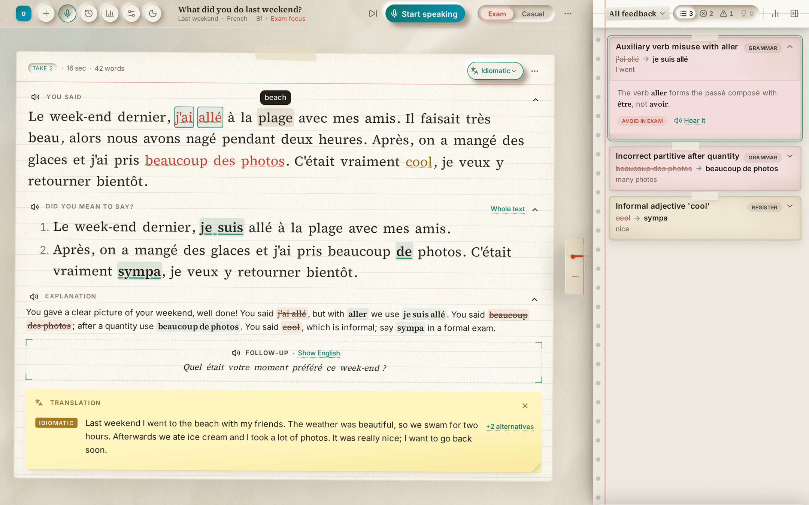
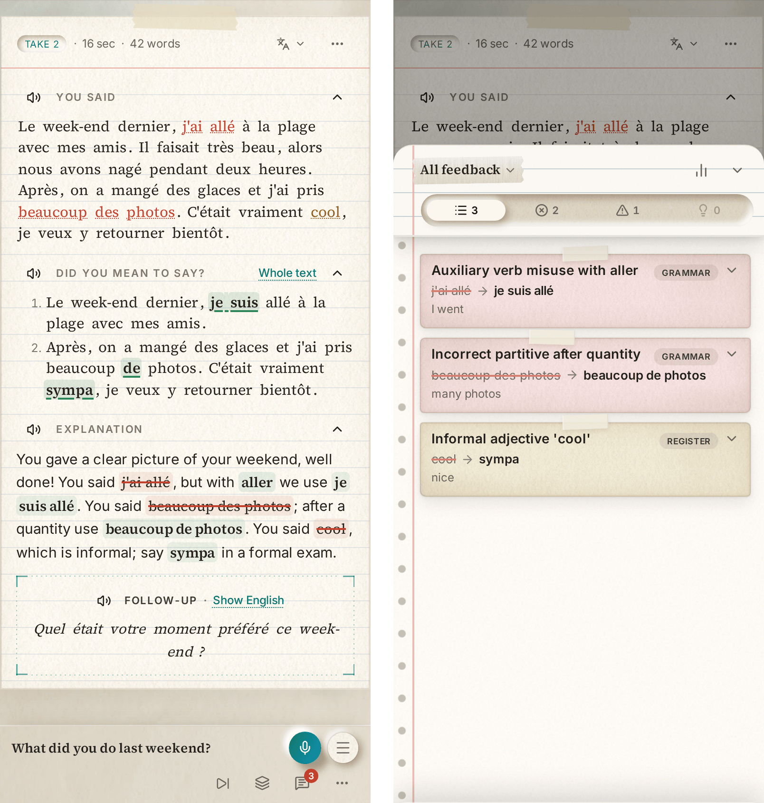
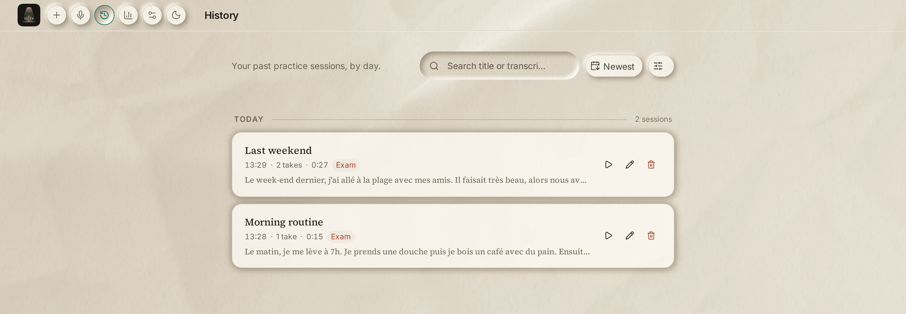
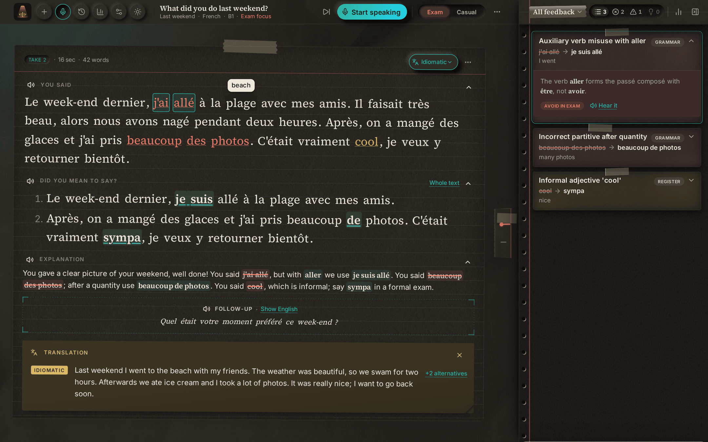
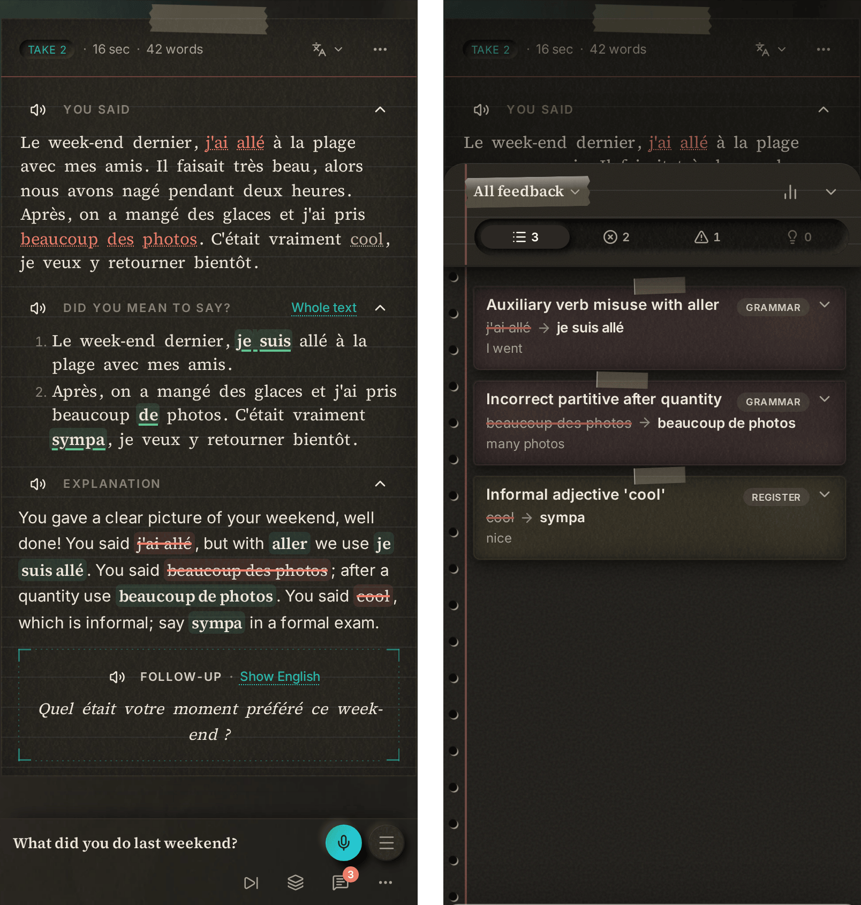
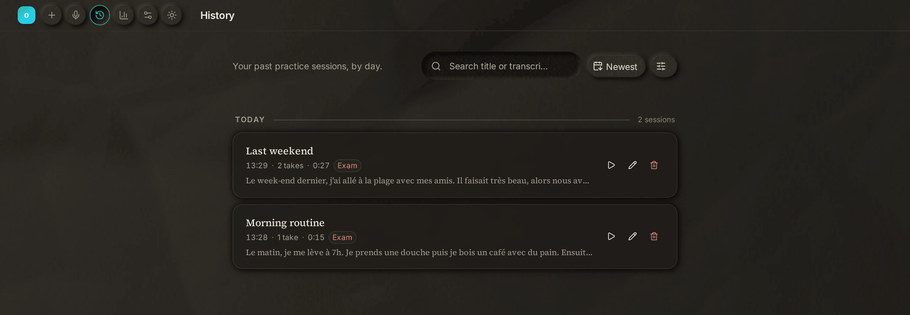

<div align="center">

<div style="display: flex; align-items: center; justify-content: center; gap: 8px; white-space: nowrap;">
  
  <h1 style="margin: 0; font-size: 2rem; line-height: 1; display: flex; align-items: center;">onspot</h1>
</div>

### Stop tapping flashcards. Open your mouth.

**The language learning app that makes you *speak*, then coaches you like a teacher.** onspot
gives you a prompt, listens to you talk for 60 seconds, then marks your spoken French the way a
good teacher would: every mistake pinned to the exact words you said, explained in plain English,
and read back to you the way a native speaker would say it.

[**Download the app**](https://github.com/khizardevelops/onspot/releases/latest) ·
[How it works](#how-a-session-works) ·
[Features](#what-it-does) ·
[Build from source](#build-from-source)


</div>

> [!IMPORTANT]
> **Setup (2 Minutes)**:
> To get feedback, onspot needs to connect to an AI provider. This is **completely free** and requires **no payment** info or loaded credits.
> Just grab a **free Groq key** from [console.groq.com](https://console.groq.com/keys), paste it into **Settings → LLM**, and you're ready to speak!
> 
>
> **That's it!** Speech recognition and voices run locally on your device by default however you do have the option to use cloud text-to-speech and cloud speech-to-text too
> *(Optional: If you prefer premium cloud voices over the local ones, you can add a free ElevenLabs key in Settings later. Full guide [here](https://www.google.com/search?q=%23get-your-keys-two-minutes)).*


<div align="center">

<!-- Light mode is shown first; the dark versions are one click away under Screenshots. -->


</div>

> **Early release, and honest about it.** French is the only language that is fully approved today;
> Japanese is in development. The French experience is ready for daily practice, and more
> languages are the main item on the roadmap. If that is the trade-off you can live with, you can
> be speaking within a few minutes of downloading.

---

## Why onspot

Most language apps teach you to **recognise** a language. You can read the menu, pick the right
answer and finish the streak, then freeze the moment someone asks you a question.

That gap has a name: speaking **on the spot**. It only closes by doing the uncomfortable part,
which is talking, making mistakes and being corrected. onspot is built entirely around that loop:

- **You speak first.** No multiple choice, no word banks. A prompt, a microphone and one minute.
- **You get a teacher's feedback, not a score.** Specific corrections, why they're wrong, and
  what a fluent speaker would actually say.
- **You hear it done right.** The corrected version is read aloud in a natural voice, so the fix
  goes in through your ears as well as your eyes.
- **You do it again.** Retake the same prompt and watch your takes improve side by side.

It also replaces the two things that usually stop people from practising out loud: **a tutor costs
money**, and **a classroom costs courage**. onspot is free, private, and patient. It does not care
how silly your story is; it only cares whether your French is right.

## How a session works

```
  Prompt ──▶ You speak ──▶ Transcript ──▶ Teacher-style feedback ──▶ Hear it said right ──▶ Retake
   (topic)    (30–60 s)    (on-device)     (your chosen LLM)          (on-device voice)
```

1. **Pick a prompt** in exam or casual mode.
2. **Speak** about the topic in your target language. True story, made-up story or wild
   exaggeration: it doesn't matter, as long as you keep talking and aim for accuracy. Your audio
   is transcribed **on your device** by Whisper.
3. **Get marked.** The transcript, never your audio, is sent to the language-model provider you
   chose; onspot picks its most accurate model with room for your languages. It returns
   corrections, the correct version of what you meant, a spoken explanation and translations.
4. **Listen.** The explanation plays straight away; replay what you said or the correct version
   whenever you like.
5. **Go again.** Each take slides into place in your timeline, so you can compare attempts.

## Screenshots

Click a theme to show or hide it.

<details open>
<summary><b>☀️ Light mode</b></summary>
<br>


**Practice**: Each take is an index card. Mistakes are highlighted on the words you actually said, "Did you mean to say?" lists only the sentences that needed fixing, and a teacher explains why, then asks a follow-up question in French. Hover any word for its meaning, or open a translation note. The feedback cards are tinted by how serious each mistake is.



**On a phone**: The same card edge to edge, with the controls in a bar at the bottom. Feedback slides up as a sheet.



**History**: Every session, grouped by day and searchable by title or transcript. Replay, rename or delete any of them.

</details>

<details>
<summary><b>🌙 Dark mode</b></summary>
<br>



**Practice**: Each take is an index card. Mistakes are highlighted on the words you actually said, "Did you mean to say?" lists only the sentences that needed fixing, and a teacher explains why, then asks a follow-up question in French. Hover any word for its meaning, or open a translation note. The feedback cards are tinted by how serious each mistake is.



**On a phone**: The same card edge to edge, with the controls in a bar at the bottom. Feedback slides up as a sheet.



**History**: Every session, grouped by day and searchable by title or transcript. Replay, rename or delete any of them.

</details>

## What it does

### 🎙️ Speak, don't tap
Get a speaking prompt ("Describe your morning routine", "Talk about a book that changed your
perspective"), hit record and talk for 30–60 seconds. A live waveform and timer keep you honest.

### 🎭 The real skill: making it up on the spot
**The skill is being able to lie, make up a story and tell it coherently in your target
language.** That's what speaking fluently actually is.

The topic is just a springboard. You don't have to tell the truth. Never been to Paris? Invent a
trip. Boring weekend? Make one up. Lie, exaggerate, turn your morning routine into a heist
thriller. Nobody is checking your story; onspot is checking your **language**.

Why making things up is the point, not a shortcut:

- **Real conversations don't come with a script.** Someone asks a question you didn't expect and
  you have to produce an answer *now*, with the words you have. Inventing a story under a timer
  is exactly that pressure, in a safe place.
- **Speaking exams work the same way.** Oral exams hand you a topic you may know nothing about
  and expect two coherent minutes on it. Candidates who can improvise confidently score; those
  waiting for a true story to remember stall.
- **Stories stretch your grammar.** A good story needs past tenses, sequencing ("first", "then",
  "in the end"), cause and effect, descriptions and reported speech. A true answer to "What did
  you do last weekend?" is often just "Not much". An invented one forces you to use the language
  you've been studying.
- **You learn to talk around gaps.** When you don't know a word, you rephrase, describe it or
  steer the story somewhere you *can* describe. That's the most valuable survival skill a
  speaker has, and you only build it by practising it.
- **Coherence is the test.** Anyone can string sentences together. Keeping characters, times and
  events consistent while you think in another language is the leap from "knows French" to
  "speaks French".

So the only rules are: **keep talking**, do it **in the language you're learning**, and try to say
it **correctly**. Tell the wildest story you like. onspot will mark the grammar, not the plot.

### 🧑‍🏫 Feedback like a teacher
Your answer is transcribed and analysed by a language model briefed to coach, not just grade:

- **Corrections linked to your words.** Mistakes are underlined in your own transcript; click one
  to jump to its explanation, or click the explanation to find it in what you said.
- **Severity at a glance.** Errors, warnings and suggestions are colour-coded, and you can filter
  by grammar, register, filler words or style.
- **Plain-English explanations** of *why*, pitched at your level (A1–C2).
- **Exam or casual mode.** Preparing for an exam? It holds you to formal, correct speech and flags
  anything to strictly avoid. Just chatting? It favours natural, idiomatic phrasing instead.
- **Better connectors and vocabulary.** It suggests upgrades a fluent speaker would plausibly use,
  including formal alternatives to casual fillers.
- **A spoken explanation** in English, straight to the point: what you said wrong and what to say
  instead, or "well done" and a follow-up question to keep you talking. Its text highlights your
  mistakes, the fixes and the words worth remembering.

### 🔊 Hear the fix
- Every take has three things to listen to: **what you said**, **"Did you mean to say…?"** (your
  own sentence with the mistakes fixed) and **the explanation**, which plays as soon as the take is
  marked.
- **Click any word** in your transcript to hear how it's pronounced.
- **Replay sentence by sentence**, loop it and slow it down.
- Replay **your own recording** straight after, to hear the difference.

### 🌍 Understand every word
Each take can be translated three ways, so you see *how* the language works, not just what it
means:

- **Idiomatic**: how an English speaker would really say it.
- **Literal**: faithful to the original sentence structure.
- **Word-for-word**: every token in order, broken English and all.

There's also a word-by-word breakdown and alternative phrasings when you want to dig deeper.

### 📈 See yourself improve
- **History** keeps every session, grouped by day, searchable (including regular expressions),
  with replay, rename and delete.
- **Insights** finds your *recurring* mistakes across all sessions (the patterns worth drilling)
  and takes you straight back to every time they happened.

### 🎛️ Make it sound right to you
A per-voice **4-band equaliser and volume** with a live preview. Tune the voice until it's
comfortable to listen to for an hour, without ever changing the approved defaults.

### 🧩 Choose what runs where
Speech-to-text, the LLM and text-to-speech are independent choices. Each has its own Local/Cloud
switch: run it on this device or through an API you control. The app shows exactly what still needs
downloading and exactly what leaves your device.

### ☁️ Sync to your own cloud
Back up the whole database to Google Drive's app-private folder or to any WebDAV server
(Nextcloud, ownCloud, pCloud). Sync is manual, compares both copies first, and **never replaces a
device without asking**. There is no onspot server in the middle.

## Private by design

onspot has **no server, no account and no tracking**. It was built privacy-first from day one:

| | Where it happens |
|---|---|
| Speech-to-text (your voice) | **On your device** (Whisper in a Web Worker), or Groq if you choose cloud speech-to-text |
| Text-to-speech (spoken replies) | **On your device** (Piper neural TTS in a Web Worker), or ElevenLabs / an OpenAI-compatible voice if you choose cloud text-to-speech |
| Your sessions, recordings and history | **On your device** (SQLite, in the browser or on the desktop) |
| Feedback and translation | The LLM provider **you** choose, in the cloud or on your own local server |
| Cloud backup (optional) | The Google Drive account or WebDAV server **you** configure |

- **Works offline** for whichever steps you keep on the device, once their data is downloaded.
  Any step you switch to an API is labelled with the provider that receives it.
- **Bring your own key (BYOK):** Groq, DeepSeek, ElevenLabs, or any OpenAI-compatible endpoint.
  Keys stay in your browser and are never written to your database or exports.
- **Your data is portable.** Export everything (sessions, recordings, cached audio, settings) to a
  single `.sqlite` file, restore it on another browser or computer, or sync it to your own cloud.
  Google and WebDAV credentials stay in browser storage and are never written to the database.
- **Cloud speech is optional and labelled.** Prefer Groq's hosted Whisper, ElevenLabs, or another
  OpenAI-compatible voice? Turn them on and the app tells you plainly that audio or text is leaving
  your device.

## Languages

**French is the only language that is fully approved today.** Japanese is in development and is
hidden in production builds until a human has listened to its voices and checked its transcripts.
Adding a language is not a settings toggle: it needs model selection, prompt work and a quality
pass. That is the bottleneck, and it is being worked through one language at a time.

| Language | Status | Speech recognition | Voice |
|---|---|---|---|
| 🇫🇷 French | ✅ Ready | Whisper small (q4) | Piper Tom + 3 more voices |
| 🇯🇵 Japanese | 🧪 In development | Whisper small (q4), shared with French | piper-plus with OpenJTalk (3 voices) |

Nothing is bundled with the app: each language's models download on demand from their public
hosts, and languages share what they can. Japanese reuses French's speech model, so it adds only
about 100 MB. Settings tells you exactly how much space a language will take before you download
it. Full model list and sizes: [`docs/supported-languages.md`](docs/supported-languages.md).

A language only ships once a human has **listened to its voices and checked its transcripts**.
Model choices are made by measurement, not marketing: French speech recognition runs at **5.5%
word error rate** across human-transcribed clips, and the voice won a human listening test against the alternatives. The
evidence is in [`docs/benchmarks/`](docs/benchmarks/README.md).

## Get onspot

### Get your keys (two minutes)

You can install onspot first, but you cannot get feedback until you add a key. onspot has no server
and no subscription; the key is how the app reaches a language model. Both providers have free
tiers.

#### 1. Groq — required for the default setup

Groq runs the language model that marks your speaking. The free tier is enough to try onspot. If
you prefer to use DeepSeek or a local OpenAI-compatible server, skip this step and configure that
instead.

1. Open [console.groq.com/keys](https://console.groq.com/keys) and create a free account.
2. Click **Create API Key**, name it `onspot`, and copy the key. It starts with `gsk_`.
3. In onspot, open **Settings → LLM**.
4. Paste the key and press **Test connection**. You should see a short reply.
5. If it fails, copy the whole key again. The app shows the provider's error message in full.

#### 2. ElevenLabs — optional, cloud voice only

The default voice is local Piper and needs no key. Add ElevenLabs only if you want its voices.

1. Open [elevenlabs.io/app/settings/api-keys](https://elevenlabs.io/app/settings/api-keys) and
   create a free account.
2. Create an API key and copy it.
3. In onspot, open **Settings → Text-to-speech**, switch to **Cloud**, and choose **ElevenLabs**.
4. Paste the key and pick a voice. On a free plan, use the app's **premade** voices; library
   voices require a paid plan.
5. Press **Preview** to check it works. If you do not want cloud voices, leave text-to-speech on
   **Local**.

**If a key does not work:** open an issue at
[github.com/khizardevelops/onspot/issues](https://github.com/khizardevelops/onspot/issues) with the
exact error message. Never post your key.

### Option 1 — Download the ready-to-use app (most people)

Grab the latest build for your platform from the
**[releases page](https://github.com/khizardevelops/onspot/releases/latest)**. Nothing to compile,
no terminal, no developer tools.

| Platform | Download | Notes |
|---|---|---|
| **Windows 10/11** | `.exe` installer or `.msi` | x64 and ARM64 builds |
| **macOS 10.15+** | `.dmg` | Apple Silicon and Intel builds |
| **Linux** | `.deb`, `.rpm`, `.AppImage` or Flatpak | x64 and ARM64 builds |
| **Android 7+** | `.apk` | arm64 phones and tablets |
| **Web / iPhone & iPad** | [onspot.khizardevelops.workers.dev](https://onspot.khizardevelops.workers.dev) | Install from Safari: Share → Add to Home Screen |

**Before you start, you need:**

- A **microphone** (the one in your laptop or phone is fine).
- About **400 MB of free space** for the French speech model and voice; they download once, on
  demand, and stay cached.
- A **free Groq API key** for feedback. [Create one here](https://console.groq.com/keys); the
  walkthrough is [above](#get-your-keys-two-minutes). You can also use DeepSeek or a local
  OpenAI-compatible server instead.
- *(Optional)* A **free ElevenLabs key** if you want cloud voices. The default local voice needs
  no key.
- Internet access for that first model download. After it, the speech parts work offline.

**First run, in five steps:**

1. **Create a free Groq key** at [console.groq.com/keys](https://console.groq.com/keys).
2. **Settings → Language data → Download** (about 363 MB for French, one time).
3. **Settings → LLM**: paste the key and press **Test connection**.
4. Allow the **microphone** when your system asks.
5. Pick a prompt and start talking.

> **A note on early-release builds.** The installers are not code-signed yet. On macOS, you may
> need to allow the app in **System Settings → Privacy & Security** the first time; on Windows,
> SmartScreen may ask you to confirm. On Android, you may need to allow installs from your browser
> or file manager. These warnings are expected and are being worked on.

### Option 2 — Build from source (developers)

Everything below is for running the app from this repository. If you just want to use onspot, use
the downloads above.

#### Requirements

- **Node.js 20.19+ or 22.12+** and npm
- A modern browser (Chromium, Firefox or Safari). On iPhone/iPad, install the web app from Safari
  with Share → Add to Home Screen. Speech runs on **WebAssembly**, so no GPU is needed.
- About **400 MB** of free space for a language's models
- An API key from an LLM provider for feedback. [Groq](https://console.groq.com/keys) has a free
  tier; see [Get your keys](#get-your-keys-two-minutes).
- *(Desktop only)* the [Rust toolchain and Tauri prerequisites](https://tauri.app/start/prerequisites/)

#### Run it

```sh
git clone <this-repo> onspot && cd onspot
bun install

# Restore the French pronunciation data (18 MB, gitignored)
mkdir -p static/piper-wasm
cp node_modules/@diffusionstudio/piper-wasm/build/piper_phonemize.{js,wasm,data} static/piper-wasm/

bun run dev          # web app at http://localhost:5173
bun run tauri dev    # desktop app
```

Then, in the app:

1. **Create a free Groq key** at [console.groq.com/keys](https://console.groq.com/keys).
2. **Settings → Language data → Download** (one-time, cached afterwards)
3. **Settings → LLM**: paste the key and press **Test connection**
4. Allow the **microphone** when asked, pick a prompt, and start talking

#### Build

```sh
bun run build        # static web build in build/
bun run tauri build  # desktop installer
bun run check        # type-check
```

**Android** (Tauri v2). Needs the Android SDK and NDK, a JDK 17 or 21, and Rust from rustup with
the Android targets. Copy `scripts/android.local.env.example` to `scripts/android.local.env` and
point it at your toolchain, then:

```sh
bun run android:emulator-apk   # debug APK for an x86_64 emulator
bun run android:build          # optimised, signed release APK for arm64 phones
bun run android:dev            # live reload on a connected device
```

Release signing reads `src-tauri/gen/android/keystore.properties` (gitignored).

Every push to `main` also builds the arm64 APK on GitHub Actions
(`.github/workflows/android.yml`); download it from the run's uploaded files. Pushing a `v*` tag
attaches the APK to a GitHub Release. To sign CI builds, add the repository secrets
`ANDROID_KEYSTORE_BASE64`, `ANDROID_KEY_ALIAS` and `ANDROID_KEY_PASSWORD`; without them the APK is
unsigned.

The web build is a static site, but it must be served with cross-origin isolation headers, which
local speech needs:

```
Cross-Origin-Opener-Policy: same-origin
Cross-Origin-Embedder-Policy: credentialless
```

Pushing a `v*` tag — or running the **Desktop release** workflow manually — builds every installer
for x64 and ARM64: Windows `.exe`/`.msi`, macOS `.dmg` (Apple Silicon and Intel), and Linux
`.deb`/`.rpm`/`.AppImage`/`.flatpak` (`.github/workflows/release.yml`).

Google Drive sync is optional at build time. Register an OAuth client in Google Cloud, enable the
Drive API, and set `VITE_GOOGLE_CLIENT_ID_DESKTOP` and/or `VITE_GOOGLE_CLIENT_ID_WEB` (see
`.env.example`). WebDAV needs no build configuration.

## Under the hood

| Layer | Technology |
|---|---|
| App | [SvelteKit](https://svelte.dev) (Svelte 5), static SPA via `adapter-static` |
| Desktop | [Tauri v2](https://tauri.app) |
| UI | [`@dvcol/neo-svelte`](https://github.com/dvcol/neo-svelte) neumorphic components, Tailwind CSS v4, a paper-textured theme with light and dark modes |
| Speech-to-text | [Transformers.js](https://huggingface.co/docs/transformers.js) running `whisper-small` q4 on ONNX Runtime Web (WASM), in a Web Worker; Groq Whisper in the cloud |
| Text-to-speech | [Piper](https://github.com/rhasspy/piper) and [piper-plus](https://github.com/ayutaz/piper-plus) VITS voices on ONNX Runtime Web, in a lazily loaded Web Worker; [ElevenLabs](https://elevenlabs.io) or an OpenAI-compatible API in the cloud |
| Pronunciation (G2P) | eSpeak-ng (French), OpenJTalk/jpreprocess compiled to WASM (Japanese) |
| Audio | Web Audio: EQ, compressor, limiter and loudness normalisation per voice |
| Storage | SQLite everywhere: `sqlite-wasm` on OPFS in the browser, native SQLite on desktop, behind one adapter |
| Cloud sync | Google Drive (app-private folder, OAuth 2.0) and WebDAV, as whole-database snapshots |
| Feedback | Any OpenAI-compatible chat API (Groq, DeepSeek, custom) |

Heavy work never touches the interface thread: transcription, speech synthesis and the database
each run in their own worker, so the app stays responsive while a model downloads or a voice
speaks.

## Roadmap

- **More languages**, each approved through a human listening test and transcript review
- Longer takes (today the recording stops at 60 seconds)
- Pronunciation scoring and spaced-repetition drills built from your recurring mistakes
- iPhone and iPad as an installable PWA, [live here](https://onspot.khizardevelops.workers.dev), not a native App Store app; real-device verification and the install guide are still being polished

## Contributing

Issues and pull requests are welcome. Start with [`CONTRIBUTING.md`](CONTRIBUTING.md) for the
development setup, the language approval rules and the review process. You do not have to write
code to help: testing on your machine, reporting a confusing correction, improving the docs and
adding example prompts are all useful.

- **Found a bug?** Open an issue with your platform, what you did, and what happened.
- **Want to add a language or voice?** Read [`docs/languages.md`](docs/languages.md) first: a model
  is only accepted once it has loaded and produced output in a real browser and passed a human
  quality check.
- **Looking for a place to start?** Issues labelled `good first issue` are scoped for newcomers.
- **Security problem?** Do not open a public issue; read [`SECURITY.md`](SECURITY.md).
- **Code of conduct:** [`CODE_OF_CONDUCT.md`](CODE_OF_CONDUCT.md).

The project's working notes, decisions and command reference live in
[`.agents/handoff/`](.agents/handoff/README.md).

## Licence

onspot is free software under the **GNU Affero General Public License v3.0 or later**. See
[`LICENSE`](LICENSE). Model weights and voices are downloaded from their own hosts under their own
licences, listed in [`docs/supported-languages.md`](docs/supported-languages.md).
